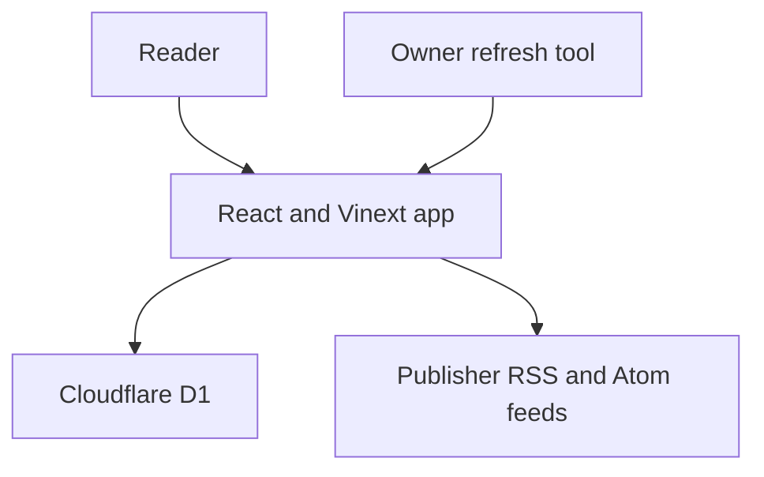

# OmniPulse

**A source-linked reading desk for AI, technology and markets.**

[Live product](https://omnipulse.sifath75.chatgpt.site) · [Sources & methodology](https://omnipulse.sifath75.chatgpt.site/about) · [Portfolio case study](CASE_STUDY.md)

## What works today

- Public edition with AI, Tech and Markets filters, searchable titles and summaries, and shareable filter URLs.
- Publisher headlines and short excerpts, with direct links to original reports.
- Browser-local reading list for up to 100 saved stories, retained across visits.
- Further-reading cards selected from available publisher summaries.
- Responsive editorial layout, keyboard controls, reduced-motion styles, and visible feed freshness.
- Persistent feed cache with independent source failures, URL validation and refresh throttling.

The edition checks feeds on visits at most every 15 minutes. It shows up to 24 items per category from the previous seven days. An open page refreshes every 15 minutes and when the reader returns. Publisher excerpts are not generated analysis, and feed updates are not real-time market data.

## Launch status

| Feature | Status |
| --- | --- |
| Public news product | Live |
| Saved stories | Browser-local; no cross-device sync |
| Automatic updates while closed | Owner tool implemented; connection and schedule pending |
| Morning newsletter | Implemented; email provider, verified sender and delivery schedule pending |
| Focus premium edition | $7 CAD/month implementation; email launch and Stripe configuration pending |
| Public GitHub repository | [arrafis/omnipulse](https://github.com/arrafis/omnipulse); deployment remains on Sites |

Email signup is disabled until delivery is configured. Paid checkout is disabled until both newsletter and billing settings are ready. No payment is accepted during setup.

## Architecture



| Layer | Implementation |
| --- | --- |
| UI | React 19, TypeScript, CSS editorial layout |
| Server | Vinext, Cloudflare Workers |
| Storage | Cloudflare D1 with Drizzle migrations |
| Feed ingestion | Bounded RSS/Atom parsing, allowlisted HTTPS story hosts, 6.5-second fetch timeout |
| Reading list | Validated localStorage snapshots, maximum 100 items |
| Email | Resend integration, confirmed opt-in, signed preferences/unsubscribe links, delivery log |
| Billing | Stripe Checkout, verified webhook entitlements, customer portal |
| Background interface | Owner-authorized Site MCP tools |

## Run locally

Requires Node.js 22.13 or later and pnpm matching `packageManager` in `package.json`.

```sh
pnpm install --frozen-lockfile
pnpm test
pnpm typecheck
pnpm build
```

The build creates `dist/server/wrangler.json`. Before running against a new local database, apply each SQL file under `drizzle/` in numeric order:

```sh
node --import ./scripts/sites-env.mjs ./node_modules/wrangler/bin/wrangler.js d1 execute DB --local --config dist/server/wrangler.json --persist-to .wrangler/state --file drizzle/0000_new_gamma_corps.sql
```

Repeat with the remaining migration filenames. Do not replay migrations already applied. Then run `pnpm dev`. Local state and credentials are ignored by Git. Local feed fetches require internet access.

## Background updates

The Site exposes `refresh_omnipulse_news` and `deliver_omnipulse_morning_digest` through its owner plugin. Calls enforce the original owner's authenticated identity; public discovery does not grant write access.

Install/connect the OmniPulse plugin, verify a refresh and D1 readback, then link the hourly schedule. Digest delivery processes at most 25 confirmed subscribers per call; repeat while `remaining` is true. Idempotency and delivery records prevent repeat delivery for the same Toronto date. Never put secrets in automation prompts.

See [NEWSLETTER_SETUP.md](NEWSLETTER_SETUP.md) for required runtime settings, sender verification, billing, and launch checks.

## Verification

`pnpm test` covers RSS/Atom parsing, unsafe hosts and URLs, invalid dates/entities, bounded excerpts, and corrupt/unsafe/duplicate reading-list records. It also checks server-rendered category/search states and the MCP protocol/authentication boundary with stubbed services. `pnpm typecheck` checks application types. `pnpm build` creates the Worker artifact. Browser interaction QA must be recorded separately; these checks alone do not prove hydration or visual behavior.

## Constraints

Source availability and feed publication cadence vary. Headlines belong to their publishers. Saved stories are device-specific. Email, payments and unattended schedules require service configuration. The project does not promise investment advice, factual verification of publisher reporting, or profitable trading signals.
